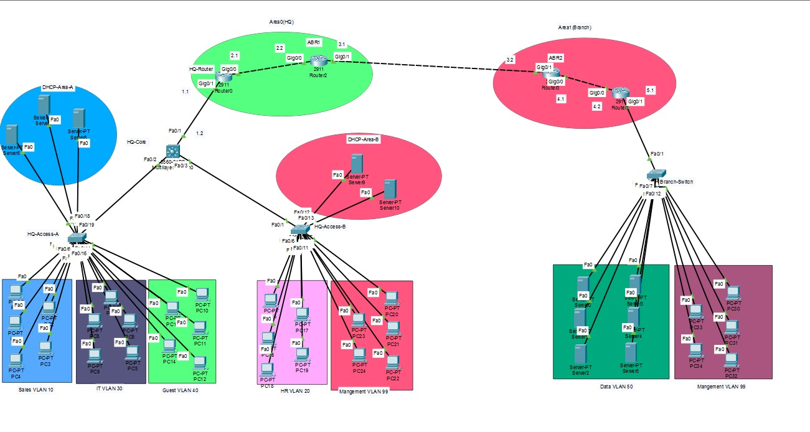

# SecureCorp — Multi-Site Enterprise Network Design & Security Hardening

A complete, functional enterprise network built in Cisco Packet Tracer — covering VLANs, Inter-VLAN Routing, DHCP, OSPF, Port Security, ACLs, and Layer 2/3 attack mitigations.

## 📋 Project Overview

**Scenario:** SecureCorp is a fictional company with:
- **HQ (Headquarters)** — 5 departments: Sales, HR, IT, Guest, Management
- **Branch Office** — connected via WAN link: Data VLAN + Management VLAN

**Primary Goals:**
- Full connectivity and inter-VLAN routing at both sites
- Resilient Layer 2 design
- Defensible security posture against realistic attacks
- Every protocol has a genuine functional purpose

## 🗺️ Network Topology

### Devices

| Device | Role |
|--------|------|
| HQ-Core (L3 Switch) | Core switch, SVIs, DHCP server, OSPF |
| HQ-Access-A | Sales, IT, Guest ports |
| HQ-Access-B | HR, Management ports |
| HQ-Router | Edge router, OSPF, WAN link |
| ABR1 | Area Border Router (HQ ↔ Backbone) |
| ABR2 | Area Border Router (Branch ↔ Backbone) |
| Branch-Router | Branch edge, router-on-a-stick, DHCP |
| Branch-Switch | Access switch for Branch VLANs |

## 📊 VLAN & IP Addressing Plan

| VLAN ID | Name | Site | Subnet | Gateway (SVI) |
|---------|------|------|--------|---------------|
| 10 | Sales | HQ | 192.168.10.0/24 | 192.168.10.1 |
| 20 | HR | HQ | 192.168.20.0/24 | 192.168.20.1 |
| 30 | IT | HQ | 192.168.30.0/24 | 192.168.30.1 |
| 40 | Guest | HQ | 192.168.40.0/24 | 192.168.40.1 |
| 99 | Management | HQ | 192.168.99.0/24 | 192.168.99.1 |
| 666 | Black-hole | HQ | — | — |
| 50 | Branch-Data | Branch | 172.16.50.0/24 | 172.16.50.1 |
| 99 | Branch-Management | Branch | 172.16.99.0/24 | 172.16.99.1 |

**WAN Link:** 192.168.3.0/24 — HQ-Router .1, ABR1 .2, ABR2 .1, Branch-Router .2

## 🔧 Technologies Implemented

| Technology | Status |
|------------|--------|
| VLANs (10, 20, 30, 40, 99, 666) | ✅ |
| Trunking (802.1Q) | ✅ |
| Inter-VLAN Routing (SVI) | ✅ |
| Router-on-a-Stick (Branch) | ✅ |
| DHCP (HQ-Core + Branch-Router) | ✅ |
| Multi-Area OSPF (Area 0 + Area 1) | ✅ |
| Port Security (sticky, restrict) | ✅ |
| DHCP Snooping | ✅ |
| BPDU Guard | ✅ |
| Root Guard | ✅ |
| Guest ACL (Guest-Restrict) | ✅ |
| SSH Management | ✅ |
| Black-Hole VLAN 666 | ✅ |

## 🛡️ Security Hardening

| Attack / Risk | Mitigation | Where Applied |
|---------------|------------|---------------|
| MAC flooding | Port Security (max MAC, sticky, restrict) | All access ports |
| Rogue DHCP server | DHCP Snooping (trusted uplinks) | HQ-Core, Branch-Switch |
| BPDU / STP manipulation | BPDU Guard | All access ports |
| Root bridge takeover | Root Guard | HQ-Access-A uplink (Fa0/24) |
| Guest-to-internal access | Guest-Restrict ACL | HQ-Core |
| Unauthorized management | SSH-only, local login | HQ-Router |
| Unused ports | Shutdown, parked in VLAN 666 | All unused ports |

## ✅ Verification

| Test | Command | Result |
|------|---------|--------|
| VLANs & Trunking | `show vlan brief`, `show interfaces trunk` | ✅ Verified |
| Port Security | `show port-security interface` | ✅ Violation triggered |
| DHCP | `ipconfig /all` on each PC | ✅ Correct IP, gateway, DNS |
| OSPF | `show ip ospf neighbor` | ✅ Full state |
| ACLs | `show access-lists`, ping tests | ✅ Guest blocked |

### DHCP Verification Screenshots

| PC | VLAN | IP Address |
|----|------|------------|
| PC0 | Sales (10) | 192.168.10.100 |
| PC7 | IT (30) | 192.168.30.100 |
| PC10 | Guest (40) | 192.168.40.101 |
| PC17 | HR (20) | 192.168.20.107 |
| PC20 | Management (99) | 192.168.99.101 |
| Server6 | Sales (Static) | 192.168.10.2 |

## 🛠️ Tools Used
- Cisco Packet Tracer
- Cisco IOS CLI

## 👥 Team

| Member | Role |
|--------|------|
| Mohamed Ali | Network & Security Configuration |
| Ahmed Alaa | Network & Security Configuration |

## 📁 Files Included

| File | Description |
|------|-------------|
| `SecureCorp.pkt` | Packet Tracer project file |
| `SecureCorp_Presentation.pdf` | Final presentation |
| `Topology.png` | Network topology diagram |
| `configs/` | Running configurations for all devices |
| `verification/` | DHCP verification screenshots |

## 📫 Connect
- LinkedIn: linkedin.com/in/mohamed-ali-179766255/
- Email: mohamedali60062@gmail.com